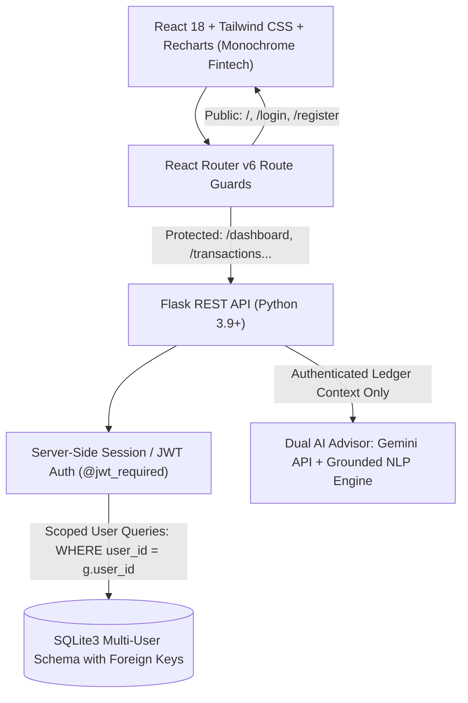

# FinAI – AI Personal Finance Management Platform ⚡

> Professional, secure, multi-user personal finance platform featuring a premium black-and-white fintech design, grounded AI financial copilot, proactive budget guardians, and strict data isolation.

---

## 🏛️ Platform Architecture

FinAI is designed from the ground up for strict multi-user privacy and deterministic financial accuracy:

1. **Multi-User Isolation**: Every user account has an isolated ledger environment in SQLite. Server-side session verification ensures queries are strictly scoped to the authenticated `user_id`. Newly registered users start with a clean account: **₹0.00 Balance, 0 Transactions, 0 Budgets**.
2. **Premium Monochrome Fintech Design**: Pure black (`#000000`), white (`#FFFFFF`), and neutral grays (`#111111`, `#777777`, `#E5E5E5`, `#F7F7F7`). No purple, no blue, no colorful gradients.
3. **Client-Side Routing (`react-router-dom`)**:
   - **Public Routes**:
     - `/` — Minimalist Public Landing Page (Zero financial data leakage)
     - `/login` — Secure Login Page (Password visibility toggle, remember me)
     - `/register` — Registration Page (Password strength meter, terms acceptance)
     - `/forgot-password` — Password Recovery Page
   - **Protected Routes (Guard Protected)**:
     - `/dashboard` — Personal Finance Dashboard with empty state for new users
     - `/transactions` — Full Transaction CRUD, search, multi-filter, sort, and CSV export
     - `/budgets` — Category-wise spending limits & overage alerts
     - `/analytics` — Income vs expense charts, category distributions, monthly trends
     - `/ai-assistant` — Context-grounded AI Copilot (fact vs forecast distinctions)
     - `/profile` — Account management, currency preference, and account deletion
     - `/settings` — Notification thresholds & display parameters



---

## 🗄️ Database Schema

### 1. `users`
| Column | Type | Constraints | Description |
|---|---|---|---|
| `id` | INTEGER | PRIMARY KEY AUTOINCREMENT | Unique User Identifier |
| `full_name` | TEXT | NOT NULL | User's full name |
| `email` | TEXT | UNIQUE NOT NULL | Account email (login username) |
| `password_hash` | TEXT | NOT NULL | PBKDF2:SHA256 hashed password |
| `currency` | TEXT | DEFAULT '₹' | Preferred currency symbol |
| `theme` | TEXT | DEFAULT 'light' | Monochrome theme |
| `alert_threshold` | REAL | DEFAULT 80.0 | Budget warning trigger (%) |
| `created_at` | TIMESTAMP | DEFAULT CURRENT_TIMESTAMP | Account creation timestamp |
| `updated_at` | TIMESTAMP | DEFAULT CURRENT_TIMESTAMP | Last profile update |

### 2. `transactions`
| Column | Type | Constraints | Description |
|---|---|---|---|
| `id` | INTEGER | PRIMARY KEY AUTOINCREMENT | Transaction ID |
| `user_id` | INTEGER | NOT NULL, FK -> users(id) | Owning user identifier |
| `transaction_type` | TEXT | CHECK IN ('income', 'expense') | Cashflow direction |
| `amount` | REAL | CHECK (amount > 0) | Numeric currency amount |
| `category` | TEXT | NOT NULL | Sector (Food, Rent, Salary, etc.) |
| `description` | TEXT | DEFAULT '' | Memo / Title |
| `payment_method` | TEXT | NOT NULL | Payment instrument |
| `transaction_date` | DATE | NOT NULL | YYYY-MM-DD |
| `created_at` | TIMESTAMP | DEFAULT CURRENT_TIMESTAMP | Ledger entry time |

### 3. `budgets`
| Column | Type | Constraints | Description |
|---|---|---|---|
| `id` | INTEGER | PRIMARY KEY AUTOINCREMENT | Budget ID |
| `user_id` | INTEGER | NOT NULL, FK -> users(id) | Owning user identifier |
| `category` | TEXT | NOT NULL | Category cap |
| `monthly_limit` | REAL | CHECK (monthly_limit > 0) | Monthly ceiling amount |
| `month` | INTEGER | NOT NULL (1-12) | Target month |
| `year` | INTEGER | NOT NULL | Target year |
| `created_at` | TIMESTAMP | DEFAULT CURRENT_TIMESTAMP | Creation time |

### 4. `user_settings`
| Column | Type | Constraints | Description |
|---|---|---|---|
| `id` | INTEGER | PRIMARY KEY AUTOINCREMENT | Settings ID |
| `user_id` | INTEGER | UNIQUE NOT NULL, FK -> users(id) | Linked User ID |
| `currency` | TEXT | DEFAULT '₹' | Currency |
| `preferences` | TEXT | DEFAULT '{}' | JSON preferences |
| `updated_at` | TIMESTAMP | DEFAULT CURRENT_TIMESTAMP | Last update |

### 5. `ai_messages`
| Column | Type | Constraints | Description |
|---|---|---|---|
| `id` | INTEGER | PRIMARY KEY AUTOINCREMENT | Message ID |
| `user_id` | INTEGER | NOT NULL, FK -> users(id) | Owning user identifier |
| `role` | TEXT | CHECK IN ('user', 'assistant') | Message sender |
| `content` | TEXT | NOT NULL | Message text |
| `metadata_json` | TEXT | DEFAULT '{}' | Financial telemetry metadata |
| `created_at` | TIMESTAMP | DEFAULT CURRENT_TIMESTAMP | Message timestamp |

---

## ⚡ Quick Start & Run Instructions

### 1. Backend Setup (Flask API)

```bash
cd backend

# Activate virtual environment
source venv/bin/activate  # On Windows: venv\Scripts\activate

# Install requirements (Flask, PyJWT, Werkzeug, Flask-CORS, requests, python-dotenv)
pip install -r requirements.txt

# Run the Flask backend
python app.py
```
*Backend runs on `http://127.0.0.1:5050`.*

### 2. Frontend Setup (React & Vite)

In a separate terminal:

```bash
cd frontend

# Install npm packages
npm install

# Start Vite dev server
npm run dev
```
*Frontend runs on `http://localhost:5173`.*

---

## 🤖 Configuring the AI Assistant (`GEMINI_API_KEY`)

FinAI incorporates a dual-mode AI engine:
1. **Google Gemini LLM Mode**: Powered by Google Gemini 1.5 Flash.
2. **Deterministic Financial Intelligence Engine**: Guarantees zero downtime if an API key is not supplied. Analyzes real transaction tables to answer questions like:
   - *"Where did I spend the most money?"*
   - *"How much did I spend this month?"*
   - *"How can I save ₹5,000 next month?"*
   - *"Am I exceeding my monthly budget?"*
   - *"Predict my next month's expenses based on my history."*

To configure Google Gemini:
1. Open `backend/.env`.
2. Add your key:
   ```env
   GEMINI_API_KEY=your_gemini_api_key_here
   ```
3. Restart the backend.

---

## 🧪 Multi-User Verification & Security Testing

Run the automated test suite verifying isolation and data persistence:

```bash
cd backend
./venv/bin/python -m unittest tests/test_api.py
```

### Verified Test Scenarios:
- **Test 1**: User A registers -> Account initialized with ₹0.00 balance, 0 transactions.
- **Test 2**: User A records ₹5,000 income and ₹1,000 expense -> Correct net balance ₹4,000.
- **Test 3**: User A logs out.
- **Test 4**: User B registers -> User B sees ₹0.00 income, ₹0.00 expense, 0 transactions.
- **Test 5**: User B attempts unauthorized access to User A's transaction -> **Access Denied (404/403)**.
- **Test 6**: User B logs out.
- **Test 7**: User A logs back in -> User A's financial ledger is intact and restored.
- **Test 8**: AI Assistant for User A accurately analyzes verified transactions.
- **Test 9**: AI Assistant for user with zero records prompts user to record transactions first.
