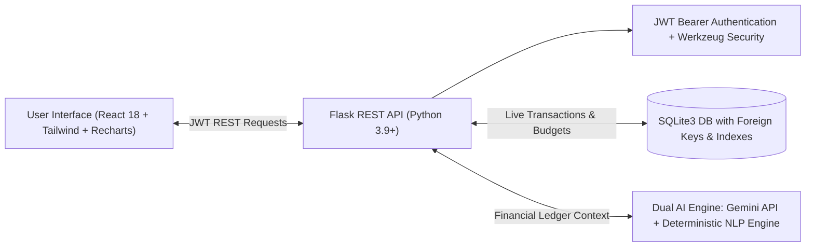

# FinAI – Smart Personal Finance Assistant ⚡

> Production-quality, full-stack, AI-powered personal finance management and predictive advisory platform.

---

## 🌟 Overview & Architecture

**FinAI** is engineered as an enterprise-grade fintech application providing end-to-end personal finance management:
1. **Financial Operations & Ledger**: Real-time CRUD tracking for income and expenses, custom categories, payment method distribution, query search, and date filters.
2. **Proactive Budget Guardian**: Monthly category-specific caps with intelligent alert triggers (safe, warning >80%, and exceeded >100%).
3. **Macro & Micro Analytics**: Interactive Recharts displaying income vs expense cash flow, category donut distributions, payment method breakdowns, and 12-month annual ledger reports.
4. **FinAI Intelligent Assistant**: AI copilot grounded directly in the user's verified transactions ledger. Accurately answers queries ("Where did I spend the most money?", "How much did I save this month?", "Can I save ₹5,000 next month?"), calculates expense forecasts, identifies unnecessary discretionary spending, and clearly distinguishes verified historical data (`[ACTUAL DATA]`) from algorithmic projections (`[PROJECTED ESTIMATE]`).



---

## 🛠️ Tech Stack

- **Frontend**:
  - React 18 (Hooks, Context API)
  - Tailwind CSS (Premium Dark Navy & Purple fintech theme, custom glassmorphism)
  - Lucide React (Fintech iconography)
  - Recharts (Interactive Area, Bar, and Donut charts)
  - Vite (Ultra-fast build tooling)
- **Backend**:
  - Python Flask (Modular Blueprints architecture)
  - SQLite3 (Relational persistence with foreign keys & indexes)
  - PyJWT & Werkzeug (Stateless token authorization & PBKDF2:SHA256 password security)
  - Flask-CORS & python-dotenv
- **AI Financial Intelligence**:
  - Dual-mode architecture: Google Gemini API integration with automated fallback to an autonomous, deterministic financial heuristics engine for guaranteed out-of-the-box zero-setup execution.

---

## 🚀 Quick Start Guide

### 1. Prerequisites
- Node.js (v18+) and npm
- Python 3.9+

### 2. Backend Setup

```bash
cd backend

# Create virtual environment
python3 -m venv venv
source venv/bin/activate  # On Windows: venv\Scripts\activate

# Install dependencies
pip install -r requirements.txt

# (Optional) Add your Gemini API Key in .env
# If omitted, FinAI will seamlessly run using its built-in deterministic financial intelligence engine!
cp .env.example .env

# Run the Flask Server
python app.py
```
*The backend starts at `http://127.0.0.1:5050`.*

### 3. Frontend Setup

In a new terminal window:

```bash
cd frontend

# Install packages
npm install

# Start Vite dev server
npm run dev
```
*The application will open at `http://localhost:5173`.*

---

## 🧪 Running Automated Tests

A comprehensive unit and integration test suite is included in `backend/tests/test_api.py`.

```bash
cd backend
./venv/bin/python -m unittest tests/test_api.py
```

**Coverage includes:**
- Health check endpoints
- User registration, login, and JWT validation
- Transactions CRUD (Create, Read with filtering/search, Update, Delete)
- Budget limit creation, overage calculations, and threshold alerts
- Analytics aggregations (monthly trend, category breakdown, payment methods, yearly audit)
- AI Advisor queries ("Where did I spend the most?", "How much did I save?", "Can I save ₹5,000?")
- Profile settings and sample data re-seeding

---

## 🔑 Key Features & Modules

### 1. User Interface & Authentication
- Modern responsive fintech dashboard with dark navy (`#070b14` / `#0b1120`) and purple (`#8b5cf6`) color scheme.
- Theme switching support (Dark & Light).
- Currency selection (₹ INR default, $, €, £, ¥, CAD, AUD).
- Password change and user profile management.

### 2. Income & Expense Management
- Real-time transaction recording with positive amounts validation and date checks.
- Categorization (Housing, Food & Dining, Groceries, Utilities, Transportation, Entertainment, Shopping, Healthcare, Subscriptions, Salary, Freelance, etc.).
- Multi-channel payment methods (UPI / Net Banking, Credit Card, Debit Card, Cash, Bank Transfer).
- Instant live search and multi-parameter filtering (by type, category, date ranges).
- CSV export capability for bookkeeping.

### 3. Budgeting & Financial Analytics
- Monthly category limits with visual progress bars.
- Dynamic alert status (`HEALTHY`, `WARNING` >80%, `EXCEEDED` >100%).
- Top-level notification bell and banner alerts for over-budget categories.
- 6-month and 12-month Income vs Expense trend charts.
- Annual Month-by-Month ledger breakdown statement.

### 4. AI Financial Assistant
- Grounded in the user's real transactions from SQLite.
- Identifies unnecessary discretionary spending (Dining, Entertainment, Luxury Shopping) and calculates 30% reduction potential.
- Accurately computes current month savings and savings rate.
- Analyzes targets (e.g., "Can I save ₹5,000 next month?") with step-by-step action plans.
- Predicts month-end expenses based on daily burn rate and historical month-over-month averages.
- Explicitly labels data with `[ACTUAL DATA - Verified]` and `[PROJECTED ESTIMATE - Forecast]` badges.
